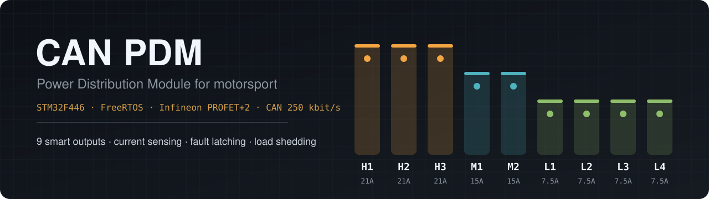
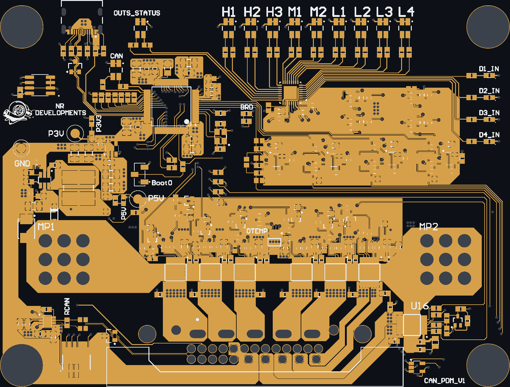
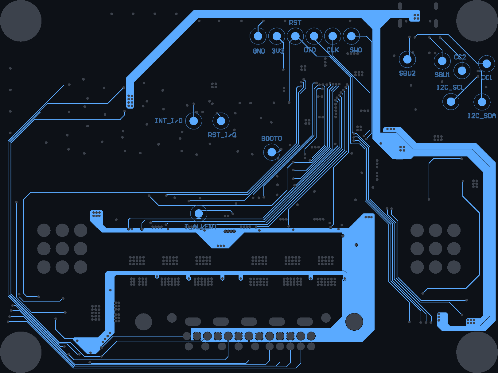
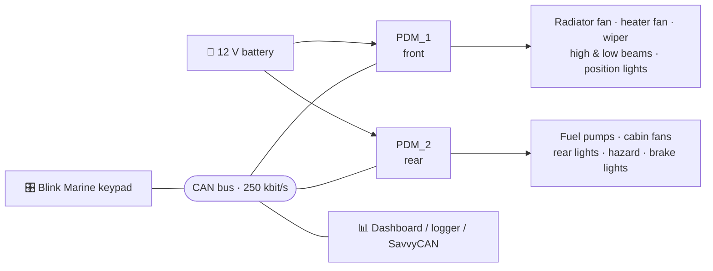
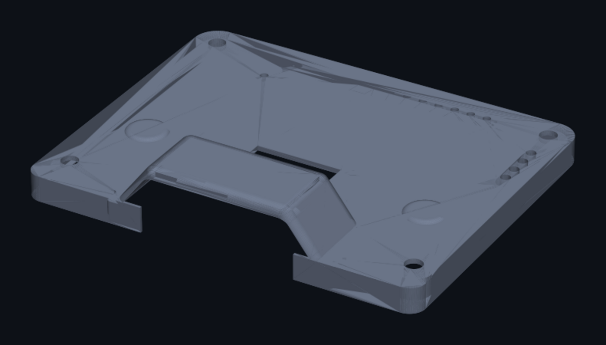
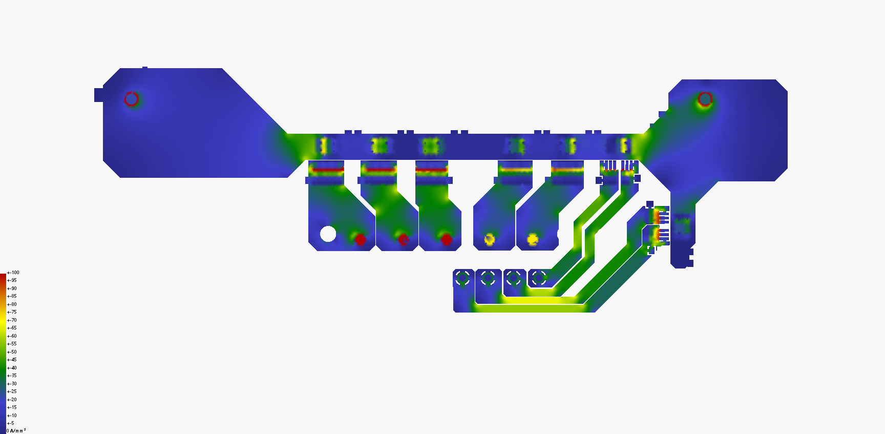
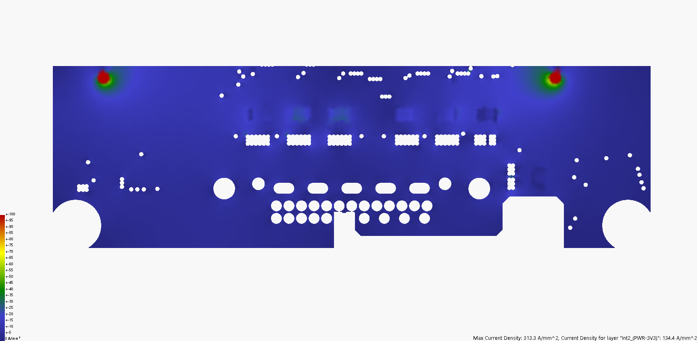
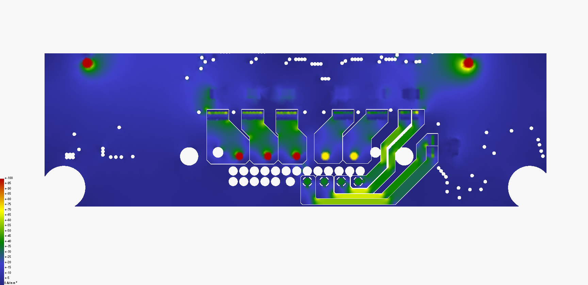
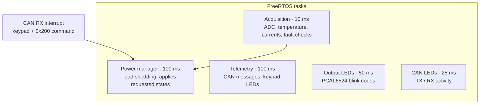

<p align="center">
  
</p>

<p align="center">
  
  
  
  
  
</p>

<p align="center">
  <b>A CAN-controlled power distribution module built for a race car.</b><br>
  It replaces fuses, relays and dashboard switches with nine protected, current-monitored outputs<br>
  switched from a Blink Marine keypad – and tells you exactly what every load is doing.
</p>

<p align="center">
  <a href="#-features">Features</a> •
  <a href="#-hardware">Hardware</a> •
  <a href="#-outputs">Outputs</a> •
  <a href="#%EF%B8%8F-protection">Protection</a> •
  <a href="#-can-interface">CAN</a> •
  <a href="#-firmware">Firmware</a> •
  <a href="#-roadmap">Roadmap</a>
</p>

---

<p align="center">
  
  
  <br>
  <sub>Top and bottom layers of the V1 board, rendered from the Altium production outputs.</sub>
</p>

<!--
  📸 Real photos go here. Suggested files:
  Docs/images/board_assembled.jpg   – assembled board, top view
  Docs/images/installed_front.jpg   – PDM_1 installed in the car
  Docs/images/installed_rear.jpg    – PDM_2 installed in the car
  Docs/images/keypad.jpg            – Blink Marine keypad on the dash

<p align="center">
  
  
</p>
-->

## ✨ Features

|   |   |
|---|---|
| ⚡ **9 smart outputs** | 3 high, 2 medium and 4 low-current channels on Infineon PROFET+2 high-side switches |
| 📈 **Current on every channel** | Measured through the PROFET current-sense output, plus battery voltage and board temperature |
| 🛡️ **Per-channel faults** | Overcurrent, short circuit and open load, with a separate inrush limit at switch-on |
| 🌡️ **Load shedding** | Outputs switched off by priority on over-temperature or under-voltage, with hysteresis and automatic recovery |
| 🎛️ **Keypad control** | Blink Marine CAN keypad: toggle outputs, reset faults, colour-coded LED feedback |
| 💡 **On-board diagnostics** | One bicolour LED per output with blink codes, plus CAN TX/RX LEDs |
| 📡 **Full telemetry** | Status, currents and fault codes on CAN every 100 ms, DBC files for SavvyCAN included |
| 🔁 **Two boards, one bus** | Identical hardware; `PDM_ID` gives each board its own CAN identity |

## 🧭 System overview



A key press goes out on the bus and reaches both PDMs. Each board checks its own key-to-output map, switches the output if the key belongs to it, and answers by updating the key LED on the keypad and the output LED on the board.

## 🔧 Hardware

<table>
<tr>
<td width="55%">

| Block | Part |
|---|---|
| MCU | STM32F446RET6, 168 MHz |
| High outputs H1–H3 | BTS7002-1EPP |
| Medium outputs M1–M2 | BTS7004-1EPZ |
| Low outputs L1–L4 | BTS7008-2EPZ (dual channel) |
| CAN transceiver | TJA1051, 120 Ω termination on board |
| Temperature | MCP9808 (I²C) |
| Status LEDs | PCAL6524 I/O expander (I²C) |
| USB | DFU through the STM32 system bootloader |
| Supply | 12 V vehicle battery |
| Extra I/O | 4 digital + 4 analog inputs, FRAM footprint (not used by firmware yet) |

</td>
<td width="45%">

<p align="center"><sub>Enclosure cover (<code>3D/Cover.stl</code>)</sub></p>
</td>
</tr>
</table>

- **PCB:** Altium Designer project in [`PCB/CAN_PDM/`](PCB/CAN_PDM/). Schematics and assembly drawings as PDF, BOM and Gerbers are in [`PCB/CAN_PDM/Project Outputs for CAN_PDM/Generate Files/`](PCB/CAN_PDM/Project%20Outputs%20for%20CAN_PDM/Generate%20Files/).
- **Mechanics:** case, cover and bus bar in [`3D/`](3D/); STEP model of the assembled board in [`PCB/3d/`](PCB/3d/).
- **Wiring:** what each output drives on the car, for both boards, is in [`Docs/`](Docs/).

### Thermal & current-density analysis

The high-current paths were checked with a DC-drop simulation before manufacturing.

<p align="center">
  
  
  
</p>

## ⚡ Outputs

The limits below are the ones currently set in the firmware. They are deliberately wide and still to be tuned for each load.

| Group | Outputs | Device | Continuous | Inrush (time) | Short-circuit | Open load | Priority |
|---|:---:|---|:---:|:---:|:---:|:---:|:---:|
| 🟧 High | H1, H2 | BTS7002-1EPP | 21 A | 81 A (1.5 s) | 50 A | < 1.0 A | High |
| 🟧 High | H3 | BTS7002-1EPP | 21 A | 41 A (1.5 s) | 50 A | < 0.5 A | High |
| 🟦 Medium | M1, M2 | BTS7004-1EPZ | 15 A | 40 A (3.0 s) | 40 A | < 0.5 A | Medium |
| 🟩 Low | L1, L2 | BTS7008-2EPZ | 7.5 A | 25 A (2.5 s) | 25 A | < 0.5 A | Low |
| 🟩 Low | L3, L4 | BTS7008-2EPZ | 7.5 A | 15 A (2.5 s) | 15 A | < 0.5 A | Low |

Load current comes from the PROFET current-sense pin: the ADC reads the voltage across a 1.2 kΩ resistor and

```
I_load = (V_sense / R_sense) × k_ILIS
```

> [!NOTE]
> The BTS7008-2EPZ is a dual-channel device with one shared sense pin: L1/L2 share one ADC input and L3/L4 share another.

## 🛡️ Protection

### Per-channel faults

Current checks run every 10 ms, and only while the output is on.

| Fault | Trigger | Reaction |
|---|---|---|
| **Overcurrent** | Current above the active limit (inrush limit during start-up, continuous limit after) | Output off immediately, fault **latched** |
| **Short circuit** | Current above the short-circuit threshold for 50 ms | Output off, fault **latched** |
| **Open load** | Current below the open-load threshold for 200 ms, checked from 500 ms after switch-on | Reported only, output stays on, clears by itself |

**Resetting a latched fault:** press the output's key. The fault is cleared and the output is switched on again; if the cause is still there, it trips again.

### Load shedding

| Level | Over-temperature | Under-voltage | Switched off | Recovery |
|---|:---:|:---:|---|:---:|
| ⚠️ Warning | > 70 °C | < 11.8 V | nothing, state reported on CAN | – |
| 🟩 Low | > 85 °C | < 11.5 V | Low-priority outputs | < 80 °C / > 12.0 V |
| 🟦 Medium | > 95 °C | < 11.2 V | Medium + Low | < 90 °C / > 11.8 V |
| 🟥 Critical | > 100 °C | < 9.5 V | **All outputs** | < 95 °C / > 10.5 V |

- Each level has its own recovery threshold, so outputs don't chatter around a limit.
- Shed outputs come back on **automatically** once the board recovers, if they are still requested on.
- High-priority outputs are only switched off at the critical level.

## 🎛️ Keypad & LEDs

<table>
<tr>
<td width="50%" valign="top">

**Blink Marine keypad**

- Press a key to **toggle** its output
- Press it on a faulted output to **reset** the fault and retry
- LED refreshed every 100 ms, so a lost frame fixes itself

| Key LED | Meaning |
|---|---|
| ⚫ Off | Output off |
| 🟢 Green | Output on |
| 🟡 Yellow, blinking | Open load |
| 🟠 Amber, blinking | Overcurrent |
| 🔴 Red, blinking | Short circuit |

</td>
<td width="50%" valign="top">

**On-board LEDs** (one green/red per output)

| LED | Meaning |
|---|---|
| Both off | Output off |
| 🟢 Steady | Output on, OK |
| 🔴 Blinking | Fault – count the blinks |

| Red blinks | Fault |
|:---:|---|
| 1 | Open load |
| 2 | Overcurrent |
| 3 | Short circuit |

Blink sequence, ~1 s pause, repeat.

</td>
</tr>
</table>

## 📡 CAN interface

| Bitrate | Cycle | Byte order | Units |
|:---:|:---:|:---:|:---:|
| **250 kbit/s** | 100 ms | Little-endian | A · V · °C |

| Message | Dir | PDM_1 | PDM_2 |
|---|:---:|:---:|:---:|
| PDM status (heartbeat, state, total current, battery, temperature) | TX | `0x300` | `0x400` |
| Fault types H / M / L1–L2 / L3–L4 | TX | `0x301`–`0x304` | `0x401`–`0x404` |
| Outputs status + current H / M / L1–L2 / L3–L4 | TX | `0x310`–`0x313` | `0x410`–`0x413` |
| Output command (bench testing) | RX | `0x200` | `0x200` |
| Keypad key event | RX | `0x18EFFF21` | `0x18EFFF21` |
| Keypad LED / brightness | TX | `0x18EF2130` | `0x18EF2131` |

| Node | Address |
|---|:---:|
| Keypad | `0x21` |
| PDM_1 | `0x30` |
| PDM_2 | `0x31` |

📘 Full byte layouts and scaling: [`FW/Doc/CAN/Can_doc_Readme.md`](FW/Doc/CAN/Can_doc_Readme.md)
🗂️ DBC files for SavvyCAN: [`FW/Dbc_Database/`](FW/Dbc_Database/)

## 🧠 Firmware

STM32CubeIDE project in [`FW/Can_PDM/`](FW/Can_PDM/), STM32 HAL + FreeRTOS. The application code lives in [`FW/Can_PDM/PDM_Drivers/`](FW/Can_PDM/PDM_Drivers/).



| File | Role |
|---|---|
| `pdm_config.c/.h` | Board identity (`PDM_ID`), thresholds, per-channel limits |
| `profet.c/.h` | Output switching, current measurement, fault detection |
| `can_manager.c/.h` | CAN filters, RX handling, telemetry frames |
| `keypad_manager.c/.h` | Key-to-output mapping, keypad LEDs and brightness |
| `io_expander.c`, `pcal6524.c` | On-board status LEDs |
| `mcp9808.c` | Board temperature sensor |
| `adc_manager.c` | DMA-driven ADC, battery voltage |

### Build & flash

1. Open `FW/Can_PDM/` in **STM32CubeIDE**.
2. In `PDM_Drivers/pdm_config.h` set the board identity:
   ```c
   #define PDM_ID PDM_1   // or PDM_2
   ```
3. Build and flash with an ST-Link, or over USB using the STM32 DFU bootloader (hold **BOOT0** at power-up).

> [!IMPORTANT]
> Each board must be built with its own `PDM_ID`. Two boards with the same ID on one bus will clash.

## 📁 Repository structure

```
.
├── 3D/                       Case, cover and bus bar models
├── Docs/                     Output wiring of PDM_1 and PDM_2 on the car
├── FW/
│   ├── Can_PDM/              STM32CubeIDE firmware project
│   │   └── PDM_Drivers/      Application code
│   ├── Dbc_Database/         DBC files (one per board)
│   └── Doc/CAN/              CAN message reference
└── PCB/
    ├── 3d/                   STEP / DXF of the assembled board
    ├── CAN_PDM/              Altium project + production outputs (PDF, BOM, Gerber)
    └── Thermal_analysis/     DC-drop / current-density simulations
```

## 🗺️ Roadmap

- [x] V1 hardware tested on the car with two boards (front + rear)
- [x] Per-channel protection, load shedding, keypad and CAN telemetry
- [ ] Parameter setup over CAN from a desktop GUI
- [ ] Settings stored in FRAM
- [ ] Firmware update over USB DFU without pressing BOOT0
- [ ] Digital and analog inputs (e.g. brake switch, sensors)
- [ ] Per-channel PROFET diagnostics (thermal, selectable sense on dual channels)

## 📄 License

Released under the [MIT License](LICENSE).

> [!WARNING]
> This hardware and firmware switch high-current circuits in a vehicle. It is provided as is, without warranty. Build and install it at your own risk.

<p align="center"><sub>Designed and built by <b>NR Developments</b></sub></p>
